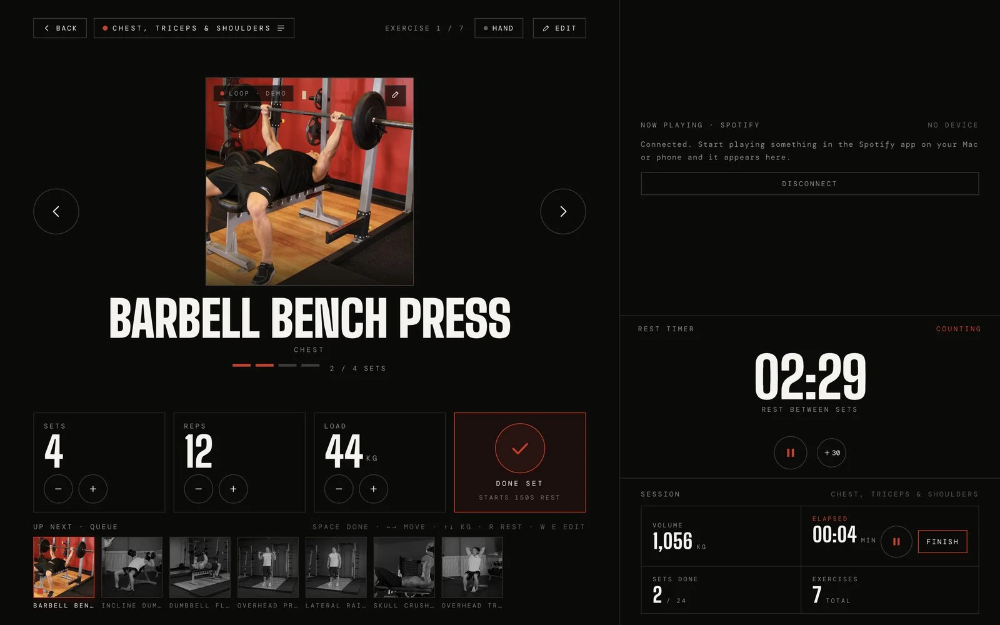
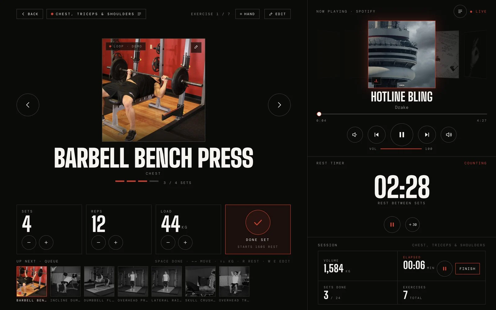
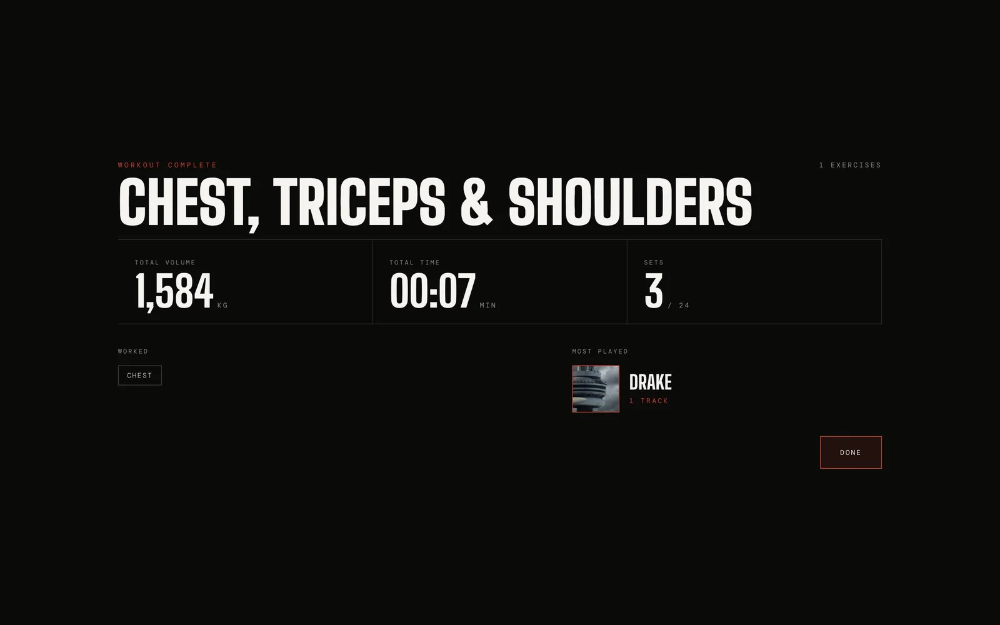
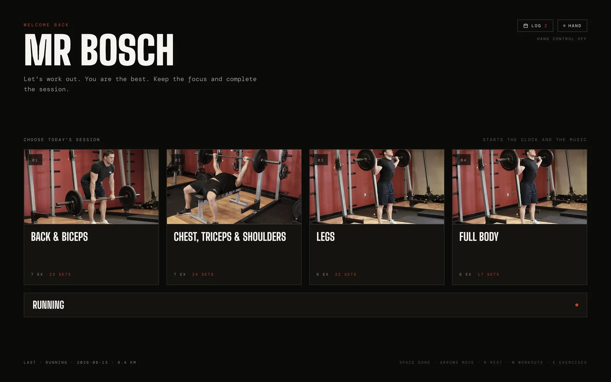

# Reps

A training screen for a garage gym that you control by pointing at the camera, so chalked hands never have to touch it.



Between sets my hands are chalked or still on the bar. Every training app I tried assumed a free, clean hand, and by the time I reached the phone it had locked. Reps keeps the whole session on one screen: the exercise and set, the rest timer, the queue and the music.

[Web version](https://home-gym-nine.vercel.app) · [Case study](https://boschwebs.website/#/work/reps)

## How it works

- **Point and hold.** MediaPipe finds the tip of your index finger. Every control confirms on a hold, with a ring that fills before anything happens, and nothing fires if you move away first.
- **One contract for every input.** The cursor sends normal pointer events, so the same controls work with a hand, a mouse, a trackpad or a touch screen. Space, Enter and the arrow keys cover the session too.
- **No swipes.** The index finger is also the cursor, so a quick move right and a swipe right are the same gesture. Changing exercise is an arrow you hold.
- **Spotify Connect** controls the Spotify app that is already playing, with no server of my own.
- **A Mac app.** `desktop/` wraps the site in Electron so the camera grant sticks and tracking starts on launch.

| Rest timer | Session summary | Picking a workout |
| --- | --- | --- |
|  |  |  |

## Run it

```sh
npm install
npm run dev
```

Built with React, TypeScript, Vite, MediaPipe Tasks Vision and Electron.
